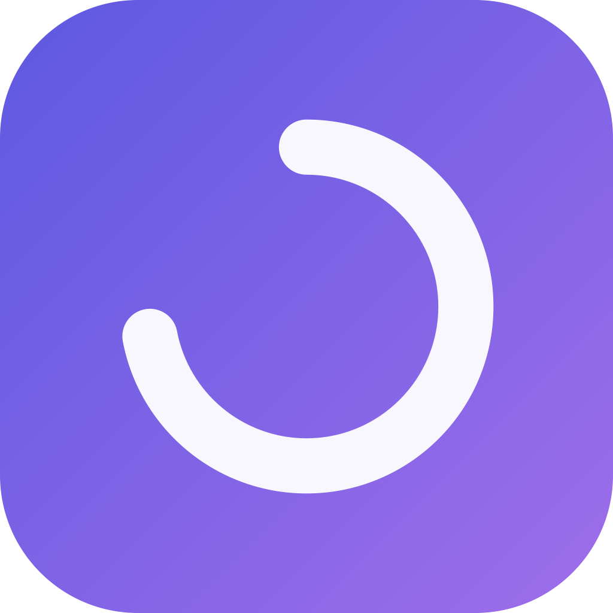
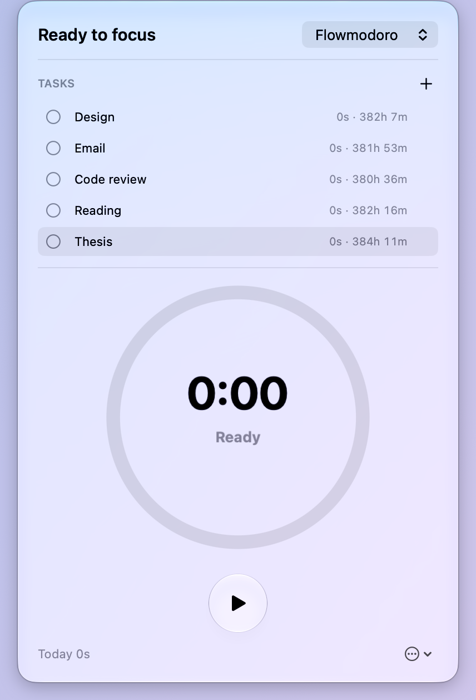
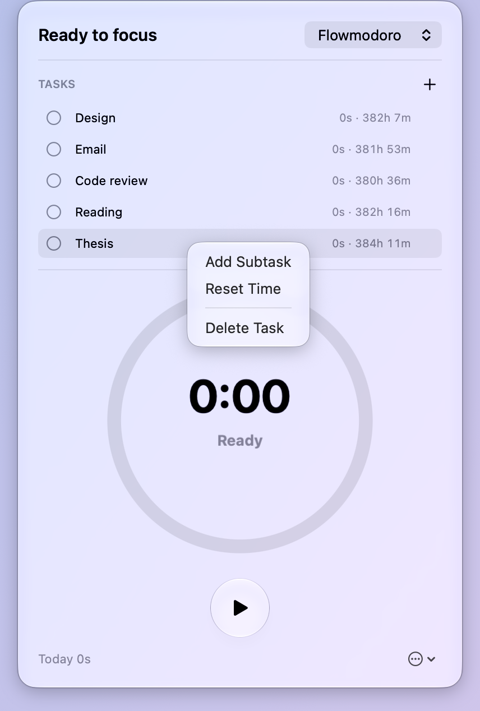
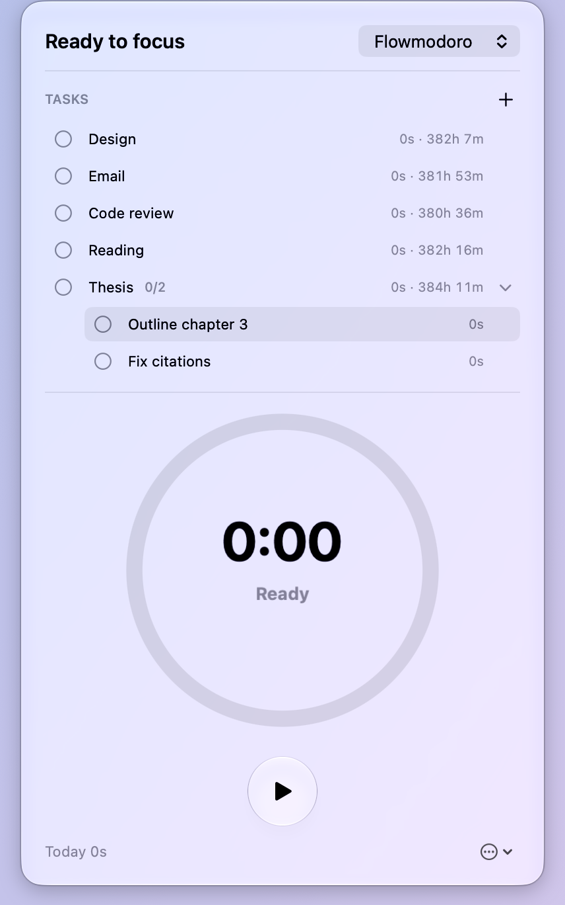
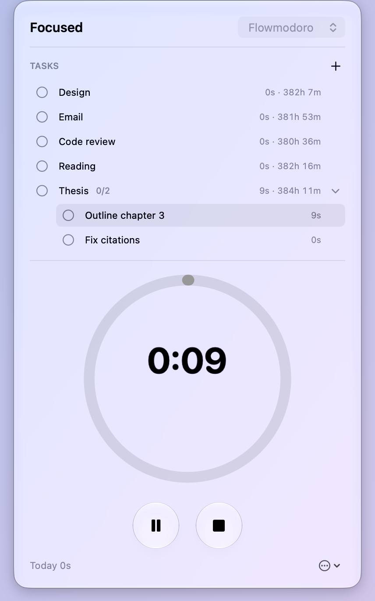
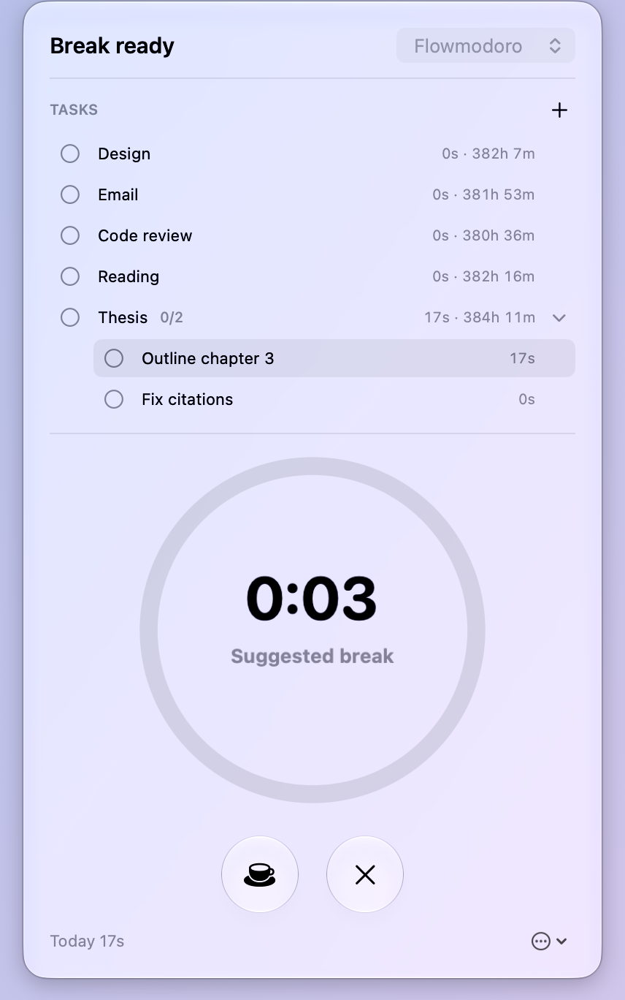
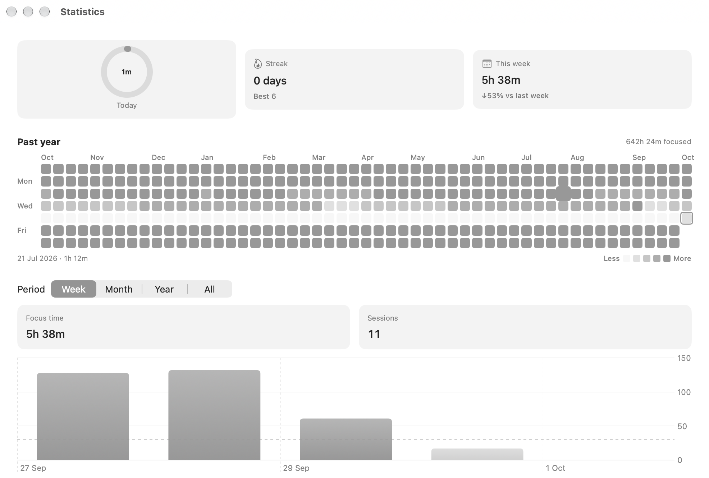
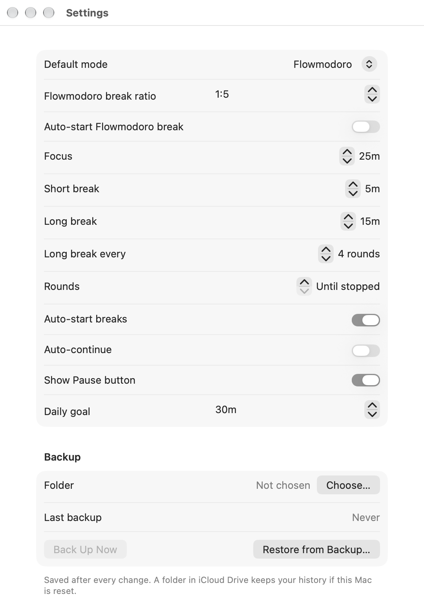
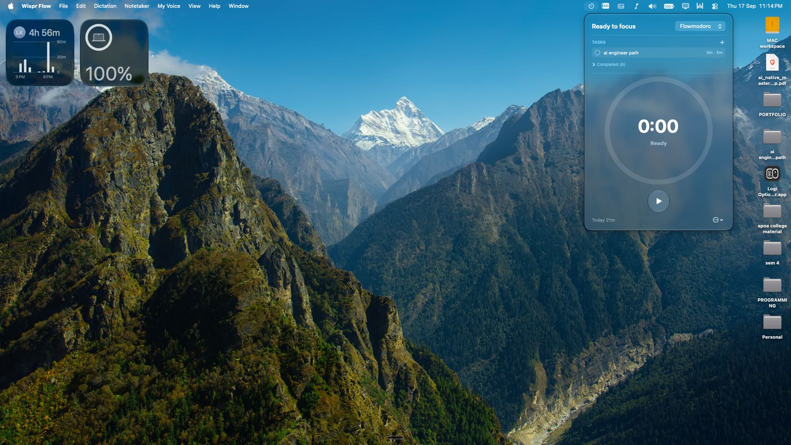
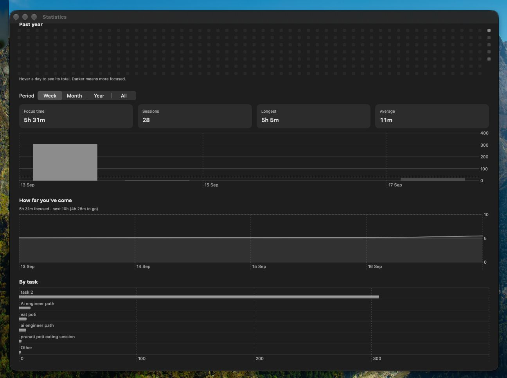

# Flowmodora

<p align="center">
  
</p>

<p align="center"><strong>A quiet little timer for the menu bar.</strong><br/>Pick one thing. Start. Let the rest of the day make sense.</p>

<p align="center">
  
  
  
  
</p>

A quiet little timer that lives in your Mac's menu bar, so you can focus on
one thing at a time — and actually see where your hours go.

## What’s new in 2.0

### Breaks you can’t miss

When a break ends, the native **Glass** chime repeats for up to 10 seconds.
Click the menu-bar item, use a global shortcut, or turn Sounds off to stop it
early. It plays at the app’s maximum volume, while still respecting your Mac’s
output volume and mute setting.

### `BREAK`, at a glance

The menu bar now says `BREAK 4:32` during a running break, `BREAK` when the
focus clock is hidden, and `BREAK READY` before a suggested break. A hidden
focus timer still uses the steaming-cup hint; a break no longer looks like one.

### Easier to hit

The footer’s Today summary and overflow menu are 20% larger, with matching
minimum hit targets. The popover’s width, order, and calm rhythm stay the same.

> Fresh v2 screenshots are deliberately not included in this checkout: the
> required Debug `-demoData` menu-bar surface was unavailable to capture in
> this environment. The tour below remains genuine historical app imagery;
> add only `-demoData` screenshots before publishing.

## What it is

Most timer apps want to be the center of attention: a big window, a loud
UI, something you have to switch to and stare at. Flowmodora is the
opposite. It sits in your menu bar, out of the way, and just keeps time
while you get on with your work. Click it, pick a task, hit play, and go
back to what you were doing. The timer keeps ticking in the corner of your
screen — a quiet companion instead of another thing demanding your
attention.

The idea borrows from two well-known ways of managing focus:

- **Pomodoro** — the classic technique. Work in fixed intervals (25
  minutes by default), take a short break, repeat, and take a longer break
  every few rounds.
- **Flowmodoro** — a gentler, more modern take built for deep work: you
  don't set a timer in advance, you just start working and let the clock
  count *up*. Whenever you naturally stop, your break is calculated from
  how long you actually focused (e.g. 1 minute of break for every 5 minutes
  worked). It respects the fact that focus doesn't always fit into neat
  25-minute boxes.

Flowmodora gives you both, side by side, and remembers what you were doing
even if you close the popover, sleep your laptop, or quit the app entirely
— your session picks up right where it left off.

It's also **local-first**: every task, session, and stat lives on your Mac.
No account, no sign-up, no internet connection required.

## A quick tour — v1.0

From the first click to a year of history — every screen below is the real app.

**1. Click the menu bar icon.** Your tasks, a timer ring and today's total
appear right where you are. Pick a task, choose Flowmodoro or Pomodoro in the
corner, and you're ready.

<p align="center">
  
</p>

**2. Right-click a task.** Add a subtask, reset just that row's time, or
delete it. Delete always asks first, and the hours you already focused stay
in your history.

<p align="center">
  
</p>

**3. Break big tasks into a checklist.** Subtasks are timeable too — their
time rolls up into the task above.

<p align="center">
  
</p>

**4. Press play.** Flowmodoro counts up while you work, and the same time
ticks on the task row and in the menu bar.

<p align="center">
  
</p>

**5. Stop when you naturally stop.** Your break is worked out from how long
you actually focused — start it, or skip it.

<p align="center">
  
</p>

**6. See where your hours went.** Today's ring, your streak, a year-long
heatmap (hover a day for its total), and charts by week, month, year or
all time.

<p align="center">
  
</p>

**7. Make it yours — and back it up.** Tune the timers, pick a daily goal, and
point Flowmodora at a folder (iCloud Drive works well) for automatic backups.

<p align="center">
  
</p>

## Features

- **Two focus modes** — Pomodoro (fixed work/break intervals, configurable
  rounds) and Flowmodoro (count up, break scales with how long you worked).
- **A task list, right in the popover** — create tasks, pick one to focus
  on, check them off, and see today's and lifetime totals per task at a
  glance. Right-click a task to add a checklist of timeable subtasks under
  it, reset just that row's time, or delete it.
- **A live menu-bar clock** — the running timer is visible in your menu
  bar at all times, so you never have to open the app to check where you
  stand. Focus remains a clock; breaks now say `BREAK m:ss`, `BREAK`, or
  `BREAK READY`, so they cannot be mistaken for a hidden focus timer.
  Right-click it for quick pause/resume/stop controls without opening the
  popover at all.
- **Survives everything** — quitting the app, sleeping your Mac, or just
  closing the popover doesn't lose your place. The timer is reconstructed
  from real timestamps, not a countdown that resets.
- **Real statistics** — today, this week, this month, this year, or all
  time, plus a per-task breakdown, a focus streak and a year-long heatmap,
  computed entirely on your device.
- **Gentle nudges** — optional notifications and sounds when an interval
  ends; the Glass chime repeats for up to 10 seconds at break end until you
  acknowledge it. Launch-at-login and light/dark/system appearance are all
  in Settings.
- **Your data, your machine** — everything above works fully offline,
  and nothing ever leaves your Mac unless you choose a backup folder.
- **Automatic backups** — pick a folder once (iCloud Drive is suggested)
  and Flowmodora saves a readable JSON copy of your tasks, sessions and
  settings after every change, keeping the last 14 days. Restore it from
  Settings after a reset or on a new Mac.

## Under the hood

Flowmodora is a native macOS app, built with a deliberately small,
"boring on purpose" architecture — the kind of app that's easy to reason
about six months later.

```
SwiftUI MenuBarExtra / windows
              ↓ user actions
AppStore (@Observable, main-actor app state)
       ↙              ↓                ↘
TimerEngine      SwiftData          system services
(timestamp math)  (local database)   (notifications, login item)
              ↓
       StatisticsEngine
       (pure, local-only calculation)
```

**Platform & UI**
- 100% **SwiftUI**, using the newest `MenuBarExtra(.window)` API to get a
  fully native, glass-material popover instead of a hand-rolled
  `NSStatusItem` + `NSPopover` — while still dropping into raw **AppKit**
  where SwiftUI doesn't reach yet (a local `NSEvent` monitor powers the
  right-click context menu on the status item, since `MenuBarExtra` has no
  secondary-click API of its own).
- **Swift Charts** renders the statistics graphs.
- **Liquid Glass** (`.glassEffect`) throughout the popover's controls, with
  identity-preserving transitions so buttons *morph* between states (play →
  pause → stop) instead of cross-fading.
- The app is `LSUIElement`, so it never touches the Dock — a true
  background utility.

**State & data**
- **SwiftData** is the single source of truth for tasks, sessions, and
  settings — four small, intentionally minimal models, no premature
  generality.
- The *running* timer is not SwiftData: it's a small `Codable` snapshot in
  `UserDefaults`, restored on launch. This means the running timer survives
  a force-quit or a crash, without ever treating a UI-recovery blob as if
  it were the real database.
- **No decrementing counters, anywhere.** Every timer value — the ring, the
  menu-bar text, a task's elapsed time — is derived live from real
  timestamps (`accumulatedFocus + (now - resumedAt)`). Waking a sleeping
  Mac or reopening the app after days away still shows the correct number
  immediately, because nothing was ever "counting" while the app wasn't
  running — it's recomputed from *when things actually happened*.
- One shared 1&nbsp;Hz clock (an async `Task` loop) drives every ticking
  view in the app, and — this is the detail that took real engineering
  effort — **it only exists while a timer is actually running**. The
  instant you pause or stop, the loop is cancelled outright. Measured cost
  while idle: effectively 0% CPU and near-zero wakeups, so leaving the app
  open all day costs you nothing.
- **`@Observable`** (the modern replacement for `ObservableObject`) is used
  throughout for state, so views only re-render the small slice of the
  screen that actually changed.

**Craft details**
- A real test suite (`flowmodoroTests`) that runs with zero network
  and zero notification permissions required —
  the timer's timestamp math and statistics calculations are validated in
  complete isolation from the outside world.
- Full internal docs in [`docs/ARCHITECTURE.md`](docs/ARCHITECTURE.md) and
  [`docs/STATUS.md`](docs/STATUS.md), including a running decisions log of
  *why* things were built this way, not just what was built.

## Build it yourself

Open `flowmodoro/flowmodoro.xcodeproj` in Xcode and run the `flowmodoro`
scheme on macOS. No API keys or accounts are needed — it runs fully
offline out of the box.

For safe visual checks, build Debug and launch with `-demoData`; it uses an
in-memory store and a separate defaults suite.

## How it started

The September 17 sketches are kept as history, not deleted:

<p align="center">
  
  
  
</p>

## Changelog and roadmap

See [CHANGELOG.md](CHANGELOG.md) for release notes. Not built yet: a widget,
a dedicated accessibility pass, Swift 6 strict concurrency migration, and real
UI-test automation for the `MenuBarExtra`; [STATUS.md](docs/STATUS.md) has the
current boundaries. This repository has no license file yet; choose one before
distributing source or binaries.
